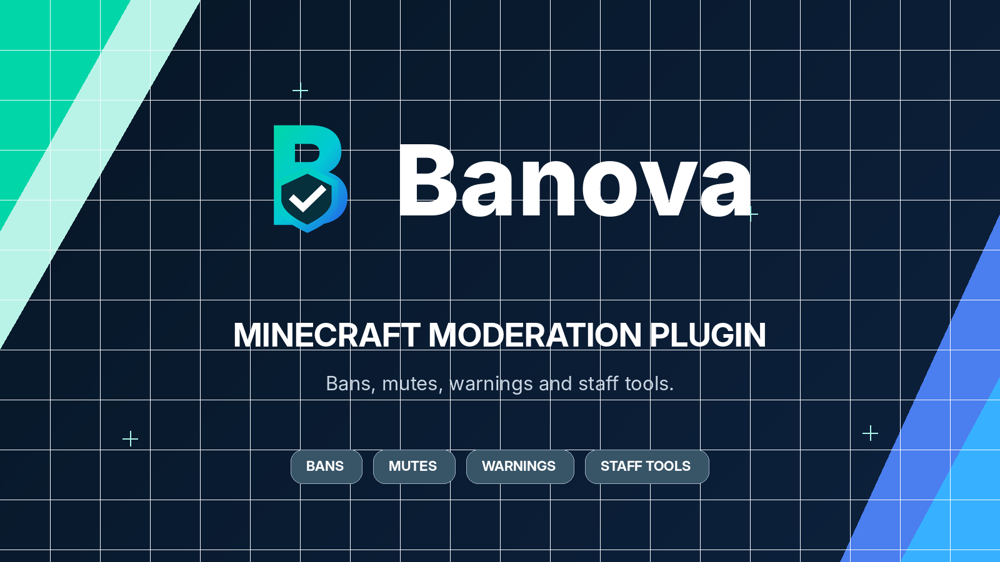
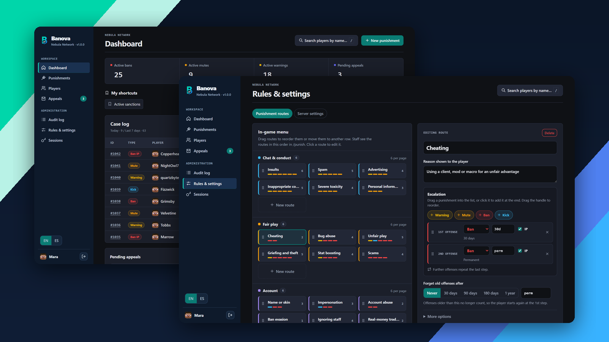
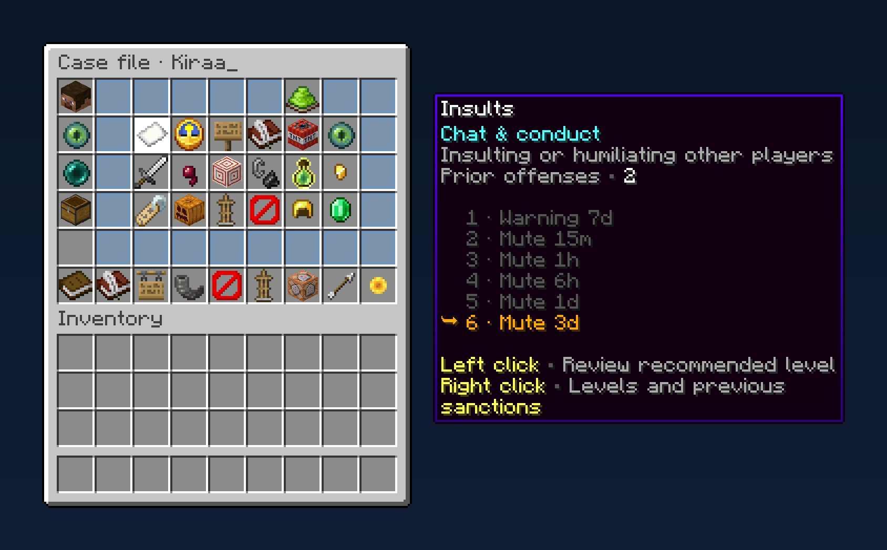
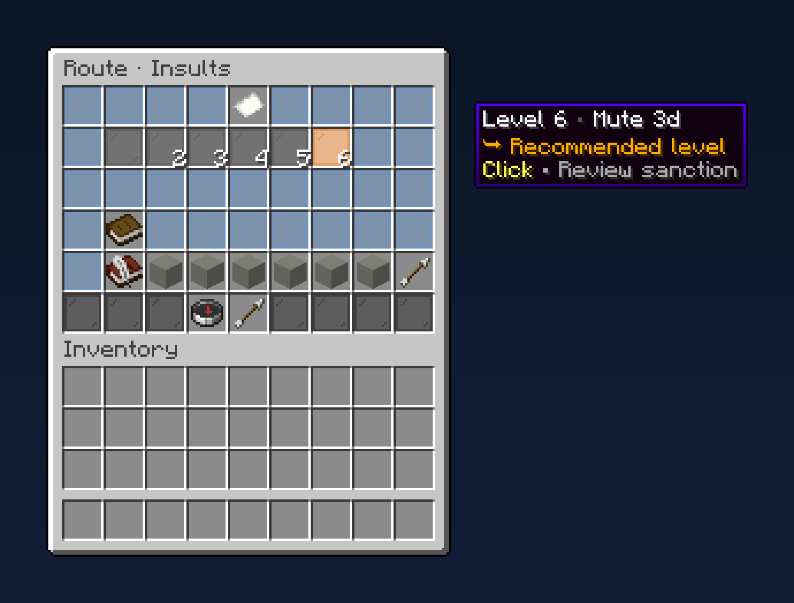
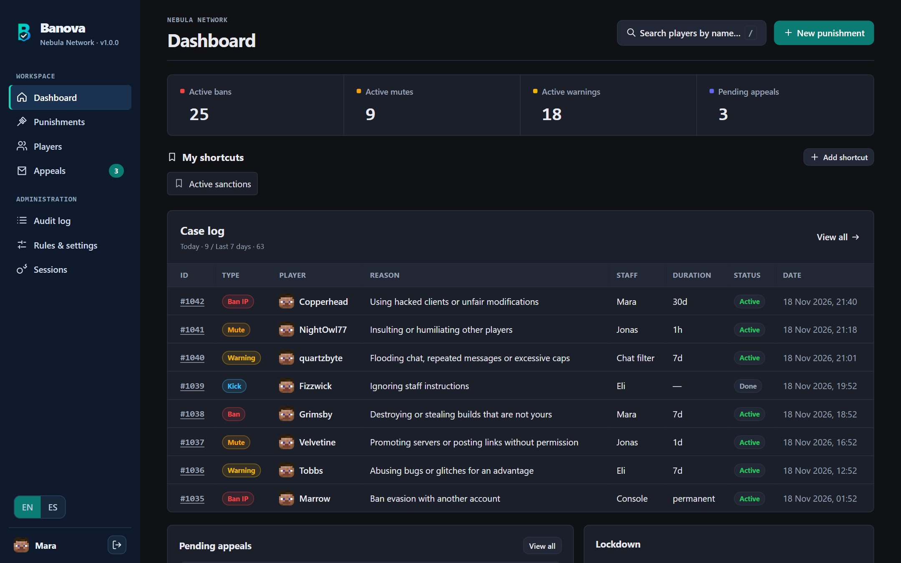
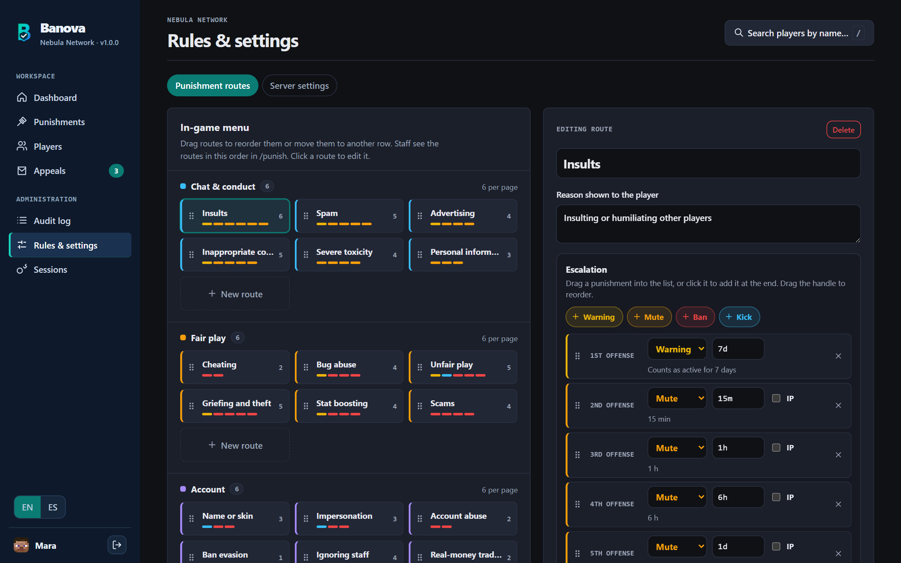

  

<b>Sistema de sanciones gratuito y moderno para servidores y redes de Minecraft.</b> 
Baneos, silencios, avisos y expulsiones con escalado automático, apelaciones, menús, filtro de chat y panel web opcional.

<a href="README.md">English</a> · <a href="docs/README.md">Documentación</a> · <a href="https://github.com/maurolopsar/banova/releases">Descargar</a>

  

---

## Por qué Banova

- **Un solo JAR** para Paper, Spigot, Folia, Velocity y BungeeCord.
- **Sin configurar nada en un servidor.** Usa una base de datos local desde el primer arranque; MySQL/MariaDB solo hace falta para redes.
- **Todo desde tres sitios.** Lo que puedes hacer en el panel web también se puede hacer en el juego con menús, desde la consola con comandos o en los archivos de configuración.
- **Pensado para el staff.** Con las plantillas de escalado nadie tiene que recordar duraciones: eliges "Hacks" y Banova aplica la sanción que toca según el historial del jugador.

## Capturas

| | |
|---|---|
|  |  |
| **`/punish`**: expediente del jugador con las rutas y el siguiente paso de cada una | **Escala de la ruta** con el nivel recomendado |
|  |  |
| **Inicio** con el registro de sanciones y las apelaciones pendientes | **Editor de rutas**: arrastra sanciones al escalado y rutas entre las filas del menú `/punish` |

## Características

- **Sanciones:** ban, tempban, ban por IP, mute, tempmute, mute por IP, aviso y kick, con modo silencioso (`-s`).
- **Escalado automático** con plantillas (`templates.yml`): 1.ª infracción aviso, 2.ª silencio 1 h, 3.ª silencio 1 día... Las infracciones pueden caducar y las apelaciones aceptadas no cuentan.
- **Umbrales de avisos:** silencio o baneo automático al llegar a X avisos activos.
- **Menús:** `/punish <jugador>` con estado, plantillas rápidas, sanciones personalizadas, historial, notas, multicuentas, pruebas y apelaciones.
- **Apelaciones:** página web pública (`/appeal`) con el código que aparece en la pantalla de baneo; los silenciados apelan en el juego con `/apelar`.
- **Pantalla de baneo útil:** motivo, staff, fecha, tiempo restante, ID y cómo apelar.
- **Notas privadas y pruebas** (enlaces o texto) en cada sanción.
- **Auditoría completa** de todo lo que hace el staff.
- **Filtro de chat:** palabras prohibidas (detecta leetspeak, tildes, letras separadas y repetidas), publicidad, spam, mayúsculas y flood, con sanción automática al repetir.
- **Detección de multicuentas** y aviso al staff si alguien entra con la IP de una cuenta baneada.
- **Herramientas de staff:** límites de duración por rango, historial y rollback del staff, cierre del servidor (lockdown), jugadores exentos.
- **Editor visual de rutas** en el panel web: arrastra sanciones para montar cada escalado y mueve rutas entre las filas del menú `/punish`. Guarda directamente en `templates.yml` respetando tus comentarios.
- **Panel web opcional** integrado, con inicio de sesión estilo LuckPerms (código + `/banova web login CÓDIGO`) y sesión persistente.
- **Redes:** Velocity + MySQL/MariaDB; los baneos se aplican en el proxy y todo se sincroniza en ~1 segundo, sin Redis.
- **Discord** mediante webhook (sin bot).
- **Importación** desde LiteBans, AdvancedBan, EssentialsX y la lista vanilla.
- **Idiomas:** inglés por defecto y español con `language: es`; todos los mensajes son editables. El panel y la página de apelaciones siguen el idioma del servidor y cada uno puede cambiarlo.
- **API** para otros plugins.

## Instalación rápida

1. Copia `Banova.jar` en `plugins/` y reinicia.
2. Da a tu staff un grupo de permisos: `banova.helper`, `banova.moderator` o `banova.admin`.
3. Abre `/punish <jugador>`. El clic izquierdo revisa el nivel recomendado. El derecho muestra la escala y las sanciones anteriores de esa ruta. La etiqueta permite añadir contexto privado antes de confirmar.
4. Para elegir otro nivel, concede `banova.route.level` y los permisos de la sanción. Desde consola usa `punish <jugador> <ruta-o-alias> nivel:N [contexto]`. La escala continúa desde el nivel más alto sin revocar dentro del plazo de la ruta.

Documentación completa (en inglés) en [docs/](docs/README.md).

## Licencia

Banova es software libre bajo la [GNU GPL v3](LICENSE).
