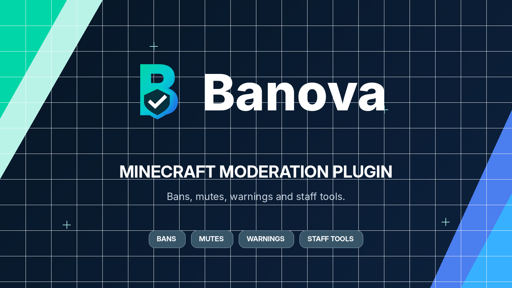
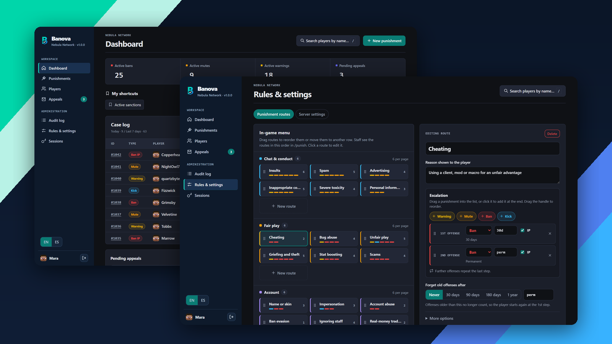

<p align="center">
  
</p>

<p align="center"><b>A free, modern punishment system for Minecraft servers and networks.</b><br>
Bans, mutes, warnings and kicks with automatic escalation, appeals, menus, a chat filter and an optional web panel.</p>

<p align="center">
  
  
  
  
</p>

<p align="center">
  <a href="docs/README.md"><b>Documentation</b></a> ·
  <a href="docs/commands.md">Commands</a> ·
  <a href="docs/permissions.md">Permissions</a> ·
  <a href="https://github.com/maurolopsar/banova/releases">Download</a> ·
  <a href="README.es.md">Español</a>
</p>

<p align="center">
  
</p>

## Why Banova?

- **One JAR** for Paper, Spigot, Folia, Velocity and BungeeCord.
- **Zero setup on a single server.** It uses a local database out of the box. Add MySQL/MariaDB when you grow into a network.
- **Everything in three places.** Anything you can do in the web panel can also be done in game with menus, from the console with commands, or in the config files.
- **Made for staff.** Templates with automatic escalation mean staff don't need to remember durations: pick "Hacks" and Banova applies the right punishment for that player's history.

## Screenshots

### In game

<table>
  <tr>
    <td width="50%"><br><b><code>/punish</code></b> · the player's case file: one row per category, the next step of each route and quick actions</td>
    <td width="50%"><br><b>Route ladder</b> · every level of the escalation with the recommended one highlighted</td>
  </tr>
  <tr>
    <td><br><b>History</b> · every punishment with reason, staff, dates and status</td>
    <td><br><b><code>/banova</code></b> · online players, search, active bans, appeals, audit log and more</td>
  </tr>
</table>

### Web panel

<table>
  <tr>
    <td width="50%"><br><b>Route editor</b> · drag punishments into the escalation and routes into the <code>/punish</code> menu rows</td>
    <td width="50%"><br><b>Dashboard</b> · case log, pending appeals and lockdown</td>
  </tr>
  <tr>
    <td><br><b>Player profile</b> · quick punish with escalation, history, notes and alts</td>
    <td><br><b>Punishment details</b> · evidence, appeal code and appeals</td>
  </tr>
  <tr>
    <td><br><b>Appeal review</b> · accept or deny with a reply</td>
    <td><br><b>Public appeal page</b> · what banned players see</td>
  </tr>
  <tr>
    <td><br><b>Server settings</b> · language, announcements and more</td>
    <td><br><b>Light theme</b> · follows the system theme</td>
  </tr>
</table>

## Features

| | |
|---|---|
| **Punishments** | Ban, temp-ban, IP ban, mute, temp-mute, IP mute, warn and kick, with silent mode (`-s`). New punishments replace older ones automatically. |
| **Automatic escalation** | Templates (`templates.yml`) with steps: 1st offense warn, 2nd 1h mute, 3rd 1d mute... Offenses can expire. Accepted appeals never count. |
| **Warning thresholds** | Automatic mute/ban when a player reaches X active warnings. |
| **Menus** | `/punish <player>`: status, quick templates, custom punishments, history, notes, alts, evidence, appeals. No commands to memorize. |
| **Appeals** | A public web page (`/appeal`) where banned players enter the code shown on their ban screen. Muted players can appeal in game with `/appeal`. Staff accept or deny from the panel, the menu or a command. |
| **Useful ban screen** | Reason, staff, date, time left, ID and how to appeal, fully configurable. |
| **Notes & evidence** | Private staff notes on players. Attach links or text to any punishment. |
| **Full audit log** | Every staff action (punish, remove, edit, notes, evidence, appeals, web logins, imports...) with who, when and from where. |
| **Chat filter** | Blocked words (detects leetspeak, accents, `i d i o t`, `idiooot`), advertising (IPs and domains with a whitelist), spam, caps and flood. Repeated violations trigger a template automatically. |
| **Alt detection** | `/alts`, and staff alerts when someone joins sharing an IP with a banned account. |
| **Staff tools** | Duration limits per rank, staff history, staff rollback, lockdown mode, exempt players. |
| **Visual rule editor** | In the web panel, drag punishments to build each escalation and drag routes between the rows of the `/punish` menu. Saves straight to `templates.yml`, keeping your comments. |
| **Optional web panel** | Built in, no web server to install. Log in like LuckPerms: the panel shows a code, you run `/banova web login CODE`. "Remember me" sessions. Dashboard, search, player profiles, appeals, audit log. Dark and light themes, English and Spanish. |
| **Networks** | Install on Velocity and on every backend with one MySQL/MariaDB database: bans are enforced at the proxy, punishments sync between servers in about a second. No Redis needed. |
| **Discord** | Webhook messages for punishments, removals and new appeals (no bot needed). |
| **Import** | `/banova import litebans | advancedban | essentials | vanilla`. Safe to run twice. |
| **Languages** | English by default, Spanish with `language: es`. Every message is editable. The panel and appeal page follow the server language and staff can switch it. |
| **API** | `BanovaApi` for other plugins and future add-ons. |

## Requirements

- **Paper or Spigot 1.18+** (tested on Paper 1.21.11 and 26.3) running Java 17 or newer.
- **Velocity 4.x** (optional, for networks).
- MySQL or MariaDB only for networks; single servers need nothing.

## Quick start

1. Drop `Banova.jar` in `plugins/` and restart.
2. Give your staff a permission group: `banova.helper`, `banova.moderator` or `banova.admin`.
3. Open `/punish <player>`. Left-click a route to review the recommended level. Right-click to see its full ladder and previous cases. Add private context with the name tag before confirming.
4. To pick a different level, grant `banova.route.level` and the relevant sanction permissions. From the console use `punish <player> <route-or-alias> level:N [context]`. The next level follows the highest non-revoked level within the route’s reset window.

Optional:

- **Web panel:** set `web.enabled: true` in `plugins/Banova/config.yml`, run `/banova reload`, open `http://your-server:8090`.
- **Network:** see [docs/network.md](docs/network.md).
- **Coming from another plugin:** `/banova import litebans` (see [docs/importing.md](docs/importing.md)).

## Building

Requires JDK 25 and Maven:

```bash
mvn package
```

The jar is written to `target/Banova-<version>.jar`. On Windows you can run `build.bat`, and `testenv/` contains scripts for a complete local test network (MariaDB + Velocity + two Paper servers). See [testenv/README.md](testenv/README.md).

## License

Banova is free software under the [GNU GPL v3](LICENSE).
